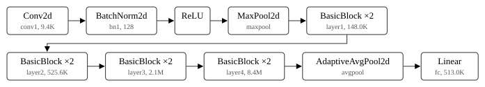

<div align="center">

# fig-check

**A paper's figures as they will print.** Text measured at its printed size (the figure's own scale in the paper
applied), colours that people with colour vision deficiency cannot tell apart, and raster images too coarse for print,
for every figure of a LaTeX project at the width each one prints at.

<a href="https://github.com/zch6a/fig-check/actions/workflows/ci.yml"></a>


<a href="LICENSE"></a>

**English** · [简体中文](README.zh-CN.md)

</div>

---

A figure made 6 inches wide with 10 pt labels and printed in a 3.25-inch column has 5.4 pt labels. A red line and a
green line are the same line to about one in twelve men of Northern European ancestry. A 640-pixel image stretched over the text width prints at
116 pixels per inch. None of this shows on screen, where you zoom; fig-check finds it before the reviewers do.

```bash
uvx --from git+https://github.com/zch6a/fig-check fig-check paper/
```

(`pip install git+https://github.com/zch6a/fig-check` for the Python API below. It reads local files only and sends
nothing anywhere.)

```
fig-check: main.tex: NeurIPS (detected): text 5.50 in, column 5.50 in
figures/loss.pdf  (main.tex:9, figure): 2.64 in wide, at 44% of its size, smallest text 4.4 pt
  error: font: text as small as 4.4 pt when printed; 2 of 2 pieces under 7 pt (it is 10.0 pt in the file: printed at 44% of its size)
  warning: colour: #d62629 and #2ba12b look alike with deuteranopia (ΔE 4.7); with typical vision ΔE 72. Tell them apart by more than hue: line style, markers, labels, lightness
figures/samples.png  (main.tex:14, figure): 5.50 in wide, at 62% of its size
  error: resolution: 640×320 pixels printed 5.50 in wide: 116 pixels per inch (under 300)
  note: a raster image: its text cannot be measured; make it a vector figure (PDF, SVG) if it can be
figures/method.pdf  (main.tex:19, figure): 3.30 in wide, smallest text 8.0 pt
fig-check: 3 figure(s), 2 with something to fix
```

That is the made-up project in [examples/paper](examples/paper). Exit status 0 when there is nothing to fix, 1 when
there is, 2 when it could not run. `--json` gives `{"version", "limits", "projects": [{"main", "template", "how",
"text_width", "column_width"}], "figures": [{"figure", "where", "printed", "scale", "smallest", "findings", "worst"}]}`
(widths in inches, text in points).

## What it reads

- **A LaTeX project** (a folder, or its main `.tex`): every `\includegraphics`, following `\input` and `\include`, at
  the width it prints at: `width=`, `height=`, `scale=`, `\resizebox`, and the line width inside `figure` (the
  column), `figure*` (the text), `wrapfigure`, `subfigure` and `minipage`. The venue's widths come from the style the
  preamble loads, or from the class options (`11pt`, `a4paper`, `twocolumn`) as LaTeX's `article` sets them; then
  from the preamble's own `geometry` options, `\setlength{\textwidth}` or `\columnsep`. `--template` names the venue
  when the preamble does not: `neurips`, `iclr`, `icml`, `cvpr`, `acl`, `aaai`, `ieee`, `acm`, `lncs` or `article`.
- **Single figures**: `fig-check plot.pdf --width 3.25in`.
- **A matplotlib figure, before it is saved** (below).
- **Formats**: PDF (read with the standard library: text, colours, embedded images, form XObjects, compressed and
  object streams), PNG (decoded for its colours), JPEG (its size), SVG. EPS is noted, not read.

| Template | Text width | Column width | From |
|---|---|---|---|
| NeurIPS | 5.5 in | (one column) | `neurips_20xx.sty` |
| ICLR | 5.5 in | (one column) | `iclr20xx_conference.sty` |
| ICML | 6.75 in | 3.25 in | `icml20xx.sty` (`\columnsep` 0.25 in) |
| CVPR, ICCV | 6.875 in | 3.28 in | `cvpr.sty`, `iccv.sty` (`\columnsep` 0.3125 in) |
| ACL, EMNLP, NAACL | 16 cm | 7.7 cm | `acl.sty` (A4, 2.5 cm margins, `\columnsep` 0.6 cm) |
| AAAI | 7 in | 3.31 in | `aaai2x.sty` (`\columnsep` 0.375 in) |
| IEEE (`IEEEtran`) | 516 pt | 252 pt | the class; `compsoc`, `onecolumn`, `peerreview`, `draftcls` too |
| ACM (`acmart`) | 506.3 pt | 241.1 pt | `sigconf`; `sigplan`, `acmtog`, `acmsmall`, `acmlarge`, `manuscript` too |
| Springer LNCS (`llncs`) | 347.1 pt | (one column) | the class |
| Elsevier (`elsarticle`), APS (`revtex4-2`) | by option | by option | `preprint`, `1p`, `3p`, `5p`; `preprint`, `twocolumn`, `reprint` |
| anything else | 345 pt | (one column) | LaTeX's `article` at 10 pt, letter paper |

Each style's widths were read from the style file itself; each class's are what pdflatex sets with that class and
those options (MiKTeX's class files, 2026-11-13; `acmart`'s after `\maketitle`, where its two columns begin).
Widths from `article`'s class options and from the preamble are worked out as `article.cls`, `size1x.clo`,
`geometry.sty` and `fullpage.sty` do. For 51 preambles (paper sizes, margins, one margin alone, ratios, `twoside`,
`landscape`, `bindingoffset`, two columns, repeated `\geometry` calls, `\PassOptionsToPackage`, `fullpage`,
`\setlength`, `\addtolength`, `\advance`) they agree with the widths pdflatex prints, to 0.01 pt, and the tests hold
those widths; `scripts/latex_widths.py` compiles them all again with your pdflatex and compares.

### In Python: a matplotlib figure

```python
from fig_check import check_figure

fig, ax = plt.subplots(figsize=(6, 4))
...
report = check_figure(fig, width="column", template="icml")  # or width=3.25, "8cm", "0.48\\linewidth", "text"
print(report)  # as the command prints it
assert report.worst != "error"  # "ok", "warning" or "error"
```

```
figure: 3.25 in wide, at 54% of its size, smallest text 5.4 pt
  warning: font: text as small as 5.4 pt when printed; 21 of 21 pieces under 7 pt (it is 10.0 pt in the file: printed at 54% of its size)
  warning: colour: #d62728 and #2ca02c look alike with deuteranopia (ΔE 4.6); with typical vision ΔE 72. Tell them apart by more than hue: line style, markers, labels, lightness
```

The figure is saved to memory as a PDF and checked like a file; nothing is written to disk. Other keyword arguments
go to `savefig` (`bbox_inches="tight"`, `dpi=300` for `imshow` images, which matplotlib rasterises at the figure's
dpi). matplotlib is not a dependency: anything with `savefig(file, format="pdf")` will do. `check_file` and
`check_bytes` check files and bytes the same way.

### Make it at the width it prints at: `paper_style`

The other fix is to make the figure at the size it will print, in the paper's font, so LaTeX does not scale it:

```python
import matplotlib.pyplot as plt
from fig_check import paper_style, save_for_paper

with plt.rc_context(paper_style("icml")):  # 3.25 in wide (ICML's column), Times, 9 pt labels, 8 pt ticks
    fig, ax = plt.subplots()
    ax.plot(steps, loss, label="ours")
    report = save_for_paper(fig, "figures/loss.pdf", "icml")  # saved at exactly 3.25 in, then checked
print(report)
```

```
loss.pdf: 3.25 in wide, smallest text 8.0 pt
  note: fonts in the PDF: STIXGeneral-Regular, TimesNewRomanPSMT
```

`\includegraphics[width=\columnwidth]{figures/loss.pdf}` then prints it at 100%. `paper_style(template, width,
height=, aspect=, font=, fontsize=)` returns plain rcParams: the figure's width (`"column"`, `"text"`, inches,
`"0.48\linewidth"`), the template's typeface (Times for NeurIPS, ICLR, ICML, CVPR and ACL; Computer Modern for
`article`), text a point under the body size and ticks two under, constrained layout (so labels stay inside the width
without `bbox_inches="tight"`, which `save_for_paper` refuses because it changes the width), and fonts embedded as
TrueType rather than Type 3. `save_for_paper` warns when the paper is in Times and the figure is not (matplotlib falls
back to DejaVu when no Times font is installed).

The typefaces and sizes are what pdflatex sets with each style file: `\f@family` and `\f@size` printed after
`\begin{document}` with `neurips_2025.sty`, `icml2025.sty`, `iclr2025_conference.sty` (with the template's `times`)
and `acl.sty` (`11pt`, `times`): Times at 10 pt, ACL at 10.95 pt. `cvpr.sty` could not be compiled here (it needs
`silence.sty`); it loads `times` and its template is `10pt`. For the other templates, pass `font="times"` or
`font="computer modern"`. End to end: a figure made with `paper_style("icml")`, included at `\columnwidth` in a paper
compiled with `icml2025.sty` (column 234.88 pt = 3.25 in), checked by fig-check: printed at 100%, smallest text 8 pt.

### The architecture figure: `diagram`

```python
import torchvision
from fig_check import diagram

d = diagram(torchvision.models.resnet18(weights=None), skip=("Identity",), per_row=5)
d.save_tikz("figures/resnet18.tex")  # \input it (with \usepackage{tikz}\usetikzlibrary{positioning}); edit the labels there
open("resnet18.svg", "w").write(d.svg())  # the same blocks as SVG, for a README or slides
```

<p align="center"></p>

It reads the model's modules (anything with `named_children()`: torch is not a dependency), collapses repeated blocks
("BasicBlock ×2", "TransformerEncoderLayer ×6", ViT's "EncoderBlock ×12"), opens containers (`nn.Sequential`,
`nn.ModuleList`), and writes TikZ that LaTeX sets in the paper's own font: each box the block's class, its name and
parameter count; `labels={"layer1": "Stage 1"}` renames, `depth=2` lists each block's parts, `direction="down"` stacks
them, `per_row` wraps a long chain. Checked on ResNet-18, `nn.TransformerEncoder` and ViT-B/16 (torchvision, no
weights downloaded): the TikZ compiles with pdflatex, and fig-check finds the compiled figures fine (5.25 in and 3.99
in wide, smallest text 8 pt, Type 1 fonts only). Two things the first version got wrong: a middle dot in the labels
made pdflatex fall back to a bitmap (Type 3) font, and 7 pt second lines were at the warning threshold.

### Or let LaTeX draw it: pgfplots

The surest fix for small text is not to shrink the figure at all. `save_pgfplots` writes a matplotlib figure as
pgfplots code, which LaTeX draws at the width it prints at, with the paper's own font at the paper's own size:

```python
from fig_check import save_pgfplots

notes = save_pgfplots(fig, "figures/loss.tex")  # width=r"\linewidth" by default; "3.25in", r"\textwidth"...
```

```latex
\usepackage{pgfplots}\pgfplotsset{compat=1.18}   % in the preamble
\begin{figure}\centering\input{figures/loss.tex}\caption{...}\end{figure}
```

The axes sit where matplotlib put them. Exported: lines (colour, opacity, width, dashes, markers, NaN gaps),
scatter points, bars and other rectangles, `fill_between`, error bars, text, axis labels, titles, limits (inverted
too), log scales, ticks with their labels (categories, dates, rotation) and the axis's scale factor, grids, legends
(where matplotlib put them, with its entries and order), `twinx` axes. Labels are escaped for LaTeX, with `$...$`
maths kept; `\mathregular` and characters like ≥, µ, α become LaTeX that pdflatex's default fonts can set. What
is not exported (images, colour bars, 3D axes, figure-level text, annotation arrows) is returned in `notes` and
written as comments at the top of the file: for those, save a PDF and check it. It fills the role tikzplotlib did, for the parts of a figure papers mostly have; the code it writes was
compiled with pdflatex and compared with the matplotlib figure.

End to end, one 6 × 4 in matplotlib figure in a two-column paper, each compiled paper checked by fig-check at its
own size: included as a PDF at the column width, its text prints at 5.3 pt (all 16 pieces under 7 pt); exported with
`save_pgfplots`, at 10 pt, the paper's own size. Figures drawn by LaTeX (TikZ, pgfplots) are counted in a note when
checking a project; their text is the paper's.

## What it checks

- **Text size when printed**: every piece of text in the figure, at its drawn size times the figure's scale in the
  paper. Under 7 pt is a warning, under 5 pt an error (`--min-font`). Elsevier's rule of thumb is "a finished, printed
  size of 7 pt for normal text" and no smaller than 6 pt for sub- and superscripts.
- **Colour vision deficiency**: every pair of colours the figure draws with that is clearly different with typical
  vision (CIEDE2000 ΔE ≥ 15) but nearly the same with protanopia, deuteranopia or tritanopia (ΔE < 6), simulated
  with Machado, Oliveira and Fernandes's matrices (2009, severity 1). Greys are left out; a figure with many colours is
  taken as a colour map, with advice instead of pairs.
- **Resolution**: raster figures, and raster images inside PDFs, in pixels per printed inch. Under 300 is a warning,
  under 150 an error (`--min-dpi`). IEEE asks more than 300 dpi for colour and greyscale images; Elsevier 300 for
  halftones. A PNG with no stated resolution is taken at 72 dpi, as pdfLaTeX does.

The colour science is checked against its sources: CIEDE2000 against all 34 pairs of Sharma, Wu and Dalal's test
data; the simulation matrices against the authors' published table.

## Limits

- Widths from a style file or class the tool does not know (memoir, an acmart format not measured...) are not
  read: it says so and uses `article`'s; give `--template`, or check figures with `--width`. Widths set in a macro,
  with `\dimexpr`, or by geometry's `includemp` are not followed; the first line of the output says which settings it
  could not read.
- Paths a macro builds (`\iftoggle{hq}{a}{b}`) are counted, not followed.
- Text drawn as outlines (paths, not fonts) is not text to it; nor is text inside raster images.
- Colours are the ones paths and text are drawn in; gradients and patterns are not followed.

## Also in this toolkit

[submit-check](https://github.com/zch6a/submit-check) checks a submission against the venue's rules ·
[paper-proof](https://github.com/zch6a/paper-proof) checks references and numbers ·
[exp-tables](https://github.com/zch6a/exp-tables) makes results tables with significance ·
[gpu-budget](https://github.com/zch6a/gpu-budget) works out GPU memory, time and cost.

## Part of research-kit

One of thirteen open research tools, from reading papers to after publication. All of them, in the order of
the work, with one Claude Code plugin marketplace for their skills: [research-kit](https://github.com/zch6a/research-kit)
· [site](https://zch6a.github.io/research-kit/).

## License

MIT.
